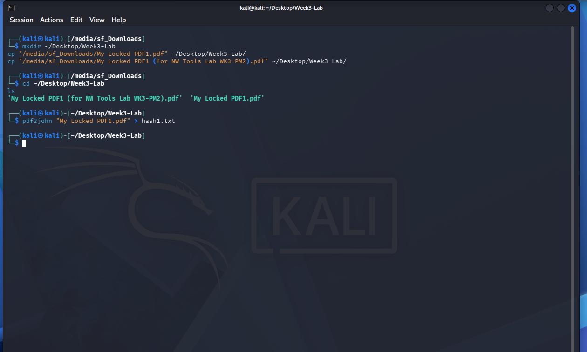
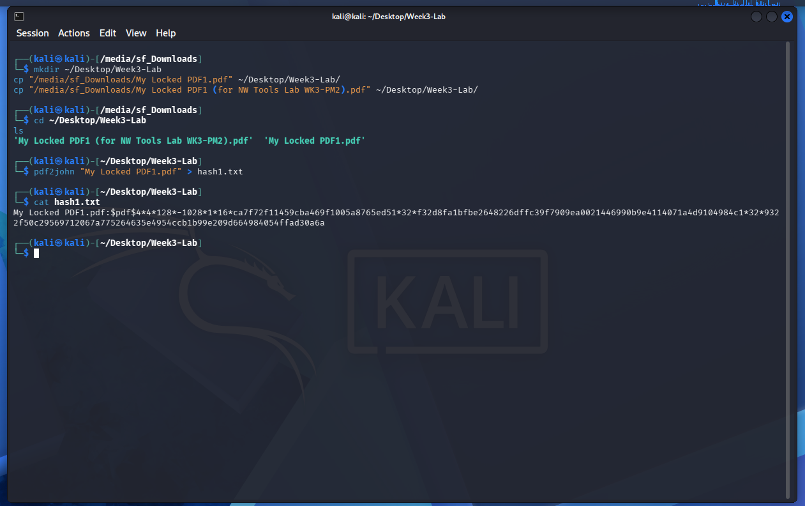
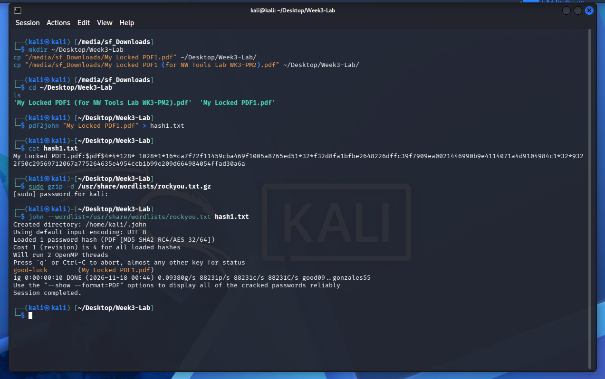
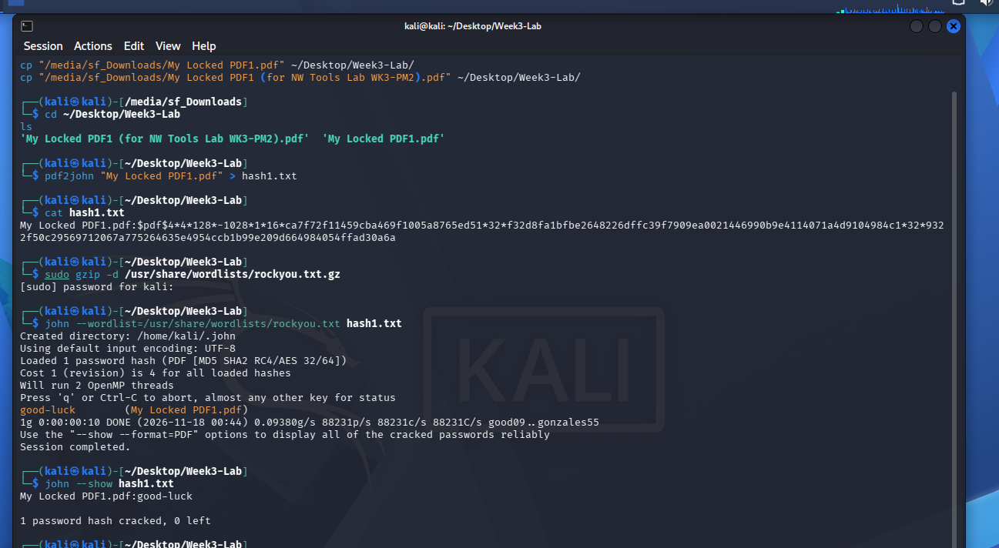
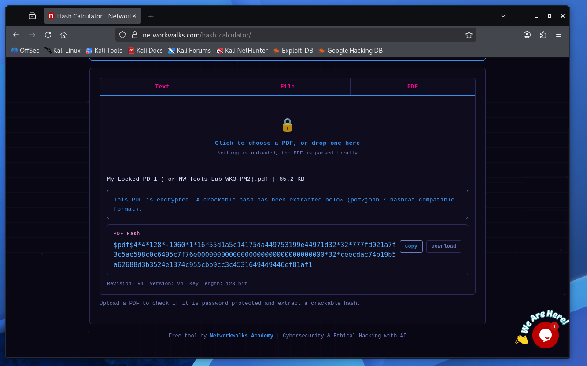
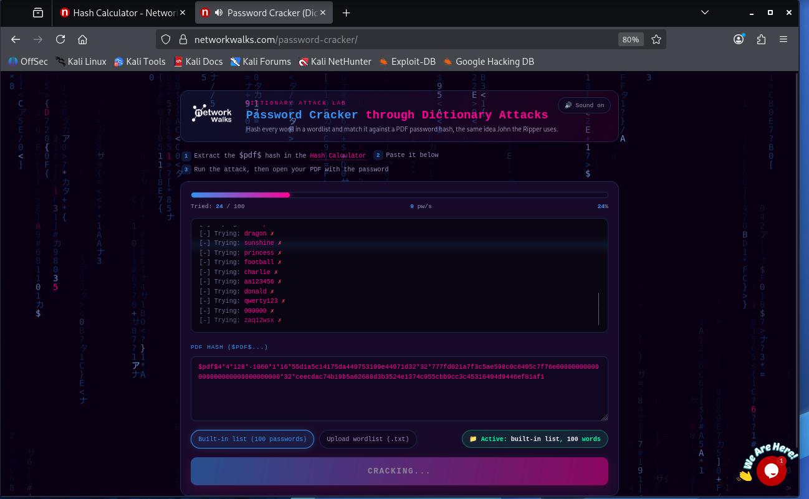
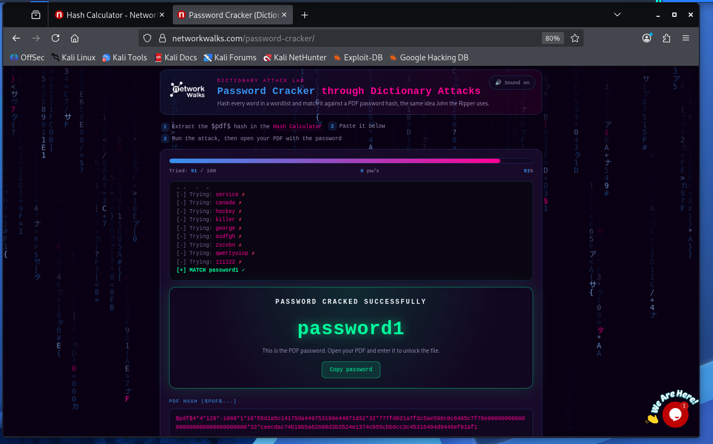
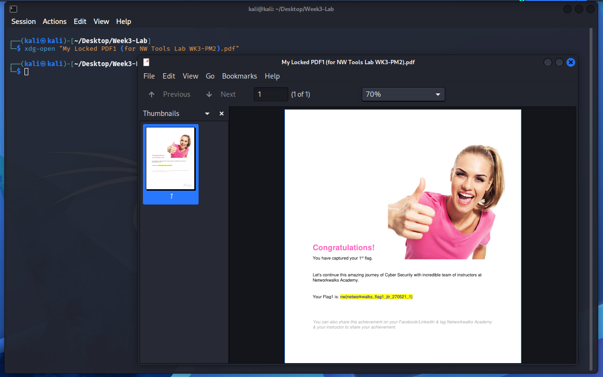

# Password Cracking Report

Cracking two password-protected PDFs with John the Ripper and with Networkwalks' own browser-based tools.

   

## 1. Report Details

| Field | Detail |
|---|---|
| Pentester Name | Aleena Zafar |
| Program / Batch | Networkwalks Cybersecurity Program, Batch B084 |
| Test date | 18 November 2026 |
| Modules completed | W3-PM1 (Password Cracking with JTR), W3-PM2 (Password Cracking with Networkwalks Tools) |

## 2. Liability Disclaimer

This work is for education and research only. Both PDFs cracked here were provided by the Networkwalks lab for this exercise, in my own VirtualBox Kali Linux environment. No system belonging to anyone else was tested.

## 3. Introduction

Week 3 of the Networkwalks Cybersecurity Program (Batch B084) covers password cracking, the next phase after footprinting and scanning: recovering a password protecting a file by testing candidate passwords against it rather than attacking it directly. Both essential modules were completed:

1. **W3-PM1:** cracking a password-protected PDF with John the Ripper (JTR) inside Kali Linux.
2. **W3-PM2:** cracking a second password-protected PDF with Networkwalks' own browser-based Hash Calculator and Password Cracker tools, which follow the same dictionary-attack idea as John the Ripper.

## 4. Module W3-PM1: Password Cracking with JTR

File: `My Locked PDF1.pdf` (copied from the shared `sf_Downloads` folder into `~/Desktop/Week3-Lab/`).

### 4.1 Extract the hash

Command: `pdf2john "My Locked PDF1.pdf" > hash1.txt`



`pdf2john` reads the PDF's encryption settings and writes them out as a hash that John the Ripper can attack, without needing the password first.

### 4.2 View the hash

Command: `cat hash1.txt`



The hash is in John's `$pdf$` format, which records the PDF's revision, key length and encrypted check values.

### 4.3 Run the dictionary attack

Commands:
```
sudo gzip -d /usr/share/wordlists/rockyou.txt.gz
john --wordlist=/usr/share/wordlists/rockyou.txt hash1.txt
```



John tried the rockyou.txt wordlist against the hash and found a match in 10 seconds.

### 4.4 Confirm the cracked password

Command: `john --show hash1.txt`



Result: `My Locked PDF1.pdf:good-luck` — the password was **good-luck**.

### 4.5 Open the PDF


The PDF opened with the cracked password and confirmed the capture.

## 5. Module W3-PM2: Password Cracking with Networkwalks Tools

File: `My Locked PDF1 (for NW Tools Lab WK3-PM2).pdf`.

### 5.1 Extract the hash with the Hash Calculator

Tool: `networkwalks.com/hash-calculator/`



Uploading the PDF to the Hash Calculator (parsed locally in the browser, not uploaded to a server) extracted the same kind of `$pdf$` hash that `pdf2john` produces, confirming the PDF is encrypted (Revision R4, Version V4, 128-bit key).

### 5.2 Run the dictionary attack

Tool: `networkwalks.com/password-cracker/`



The Password Cracker tool tested a built-in list of 100 common passwords against the hash, the same dictionary-attack idea as John the Ripper, just run in the browser instead of the terminal.

### 5.3 Password cracked



The attack matched after 91 of 100 tries. The cracked password was **password1**.

### 5.4 Open the PDF



The PDF opened with the cracked password and confirmed the capture.

## 6. Summary of Observations

- Both PDFs used weak, dictionary-guessable passwords (`good-luck` and `password1`), which is why a basic wordlist attack cracked them in seconds.
- `pdf2john` and the Networkwalks Hash Calculator do the same job: they turn a file's encryption into an offline-crackable hash without touching the original password.
- John the Ripper and the Networkwalks Password Cracker both work the same way, a dictionary attack, one from the terminal and one from the browser.
- A real-world PDF protected with a long, random passphrase would not fall to a wordlist attack this quickly.

## 7. Key Learnings

- How a PDF's password hash is extracted for offline cracking.
- How a dictionary (wordlist) attack works, and why weak passwords fail quickly against it.
- That the same cracking idea works whether the tool is a Kali command-line utility or a browser-based tool.

## Next Steps

- Continue with the next weekly projects of the Networkwalks Cybersecurity Program.
- Practise cracking with a custom wordlist instead of the default rockyou.txt.

Part of the Networkwalks Cybersecurity Program, Batch B084.
